<h1 align="center">👋 Olá, eu sou Arthur Rocha!</h1>

### 🤝 Conecte-se comigo

### 💻 Estudante de Desenvolvimento de Sistemas | Desenvolvedor em formação

Sou estudante do curso Técnico em Desenvolvimento de Sistemas. Tenho interesse em programação, desenvolvimento de software e banco de dados. Busco ampliar meus conhecimentos por meio de estudos, exercícios práticos e projetos que contribuam para minha evolução profissional na área de tecnologia.

---

## 👨‍💻 Sobre mim

- 🎓 Cursando Técnico em Desenvolvimento de Sistemas no SENAI.
- 💡 Estudando lógica de programação e desenvolvimento de software.
- 🚀 Buscando aprimorar minhas habilidades técnicas por meio de projetos práticos.
- 📚 Em constante aprendizado, com foco na evolução profissional em TI.

## 🛠️ Linguagens e tecnologias

Tecnologias com as quais já tive contato durante meus estudos:

  
  
  
  

## 🧰 Ferramentas de desenvolvimento

  
  
  
  

- **GitHub:** armazenamento, organização e apresentação de projetos.
- **Visual Studio Code:** edição de código e desenvolvimento.
- **Eclipse IDE:** ambiente de desenvolvimento utilizado nos estudos de programação.
- **MySQL:** trabalho com bancos de dados relacionais e consultas SQL.

## 📚 Conhecimentos em desenvolvimento

- Lógica de programação.
- Variáveis, operadores e estruturas condicionais.
- Estruturas de repetição e resolução de problemas.
- Fundamentos de programação em Java, JavaScript e C.
- Fundamentos de banco de dados e SQL.
- Organização e documentação de projetos.

## 🎯 Objetivos

Continuar desenvolvendo minhas habilidades em programação, fortalecer minha base em lógica e banco de dados e construir projetos que demonstrem minha evolução como desenvolvedor.

## 📂 Meus projetos

Neste perfil, compartilho exercícios, projetos acadêmicos e aplicações desenvolvidas durante minha jornada de aprendizado.

Cada projeto representa uma oportunidade de praticar conceitos, aprender novas soluções e aprimorar minhas habilidades.

---

  <i>Aprendendo continuamente, evoluindo na prática e construindo meu caminho na tecnologia.</i>

